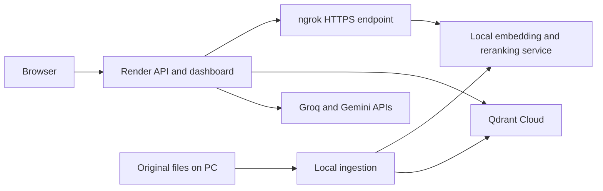

# ANRI: local models + Render deployment plan

Date: 2026-10-12. Status: planning only; no commands, tests, account changes, or deployment performed.

## Agreed architecture

Your PC runs the embedding and reranking models behind an authenticated HTTP service. A tunnel exposes that local port through HTTPS. The ANRI backend on Render calls the tunnel URL; the browser talks to Render.

| Component | Location | Responsibility |
| --- | --- | --- |
| Dashboard, FastAPI, LangGraph | Render | User requests, retrieval orchestration, answer streaming |
| Embedding and reranking service | Local PC | Existing BGE embeddings and FlashRank scoring |
| Heavy document ingestion and originals | Local PC | Parsing, chunking, optional vision API calls, source archive |
| Chunks and vectors | Existing Qdrant Cloud | Durable retrieval data |
| Generation and optional vision | Existing Groq/Gemini APIs | Current provider-based inference |

The initial target is a personal demo within free-tier limits. Hosting model compute locally does not move the existing provider-based LLM calls to a local LLM.

Query order remains the existing graph: triage -> local embedding through HTTPS -> Qdrant retrieval -> local reranking through HTTPS -> grading -> generation or rewrite/refusal. The diagram shows connections, not the sequential node order.

## 1. Verify the existing project and make Render lightweight

Re-read configuration, model-service clients, startup, dashboard handlers, and ingestion imports. Inspect Git state before implementation and preserve unrelated work. Verify the project .venv; previous sessions could not start its configured interpreter. Repair that environment before local execution when authorized.

Separate web dependencies from model/ingestion dependencies. Render must not install or import Torch, sentence-transformers, FlashRank, or Docling along its normal web startup/query path. Keep full dependencies on the PC. A separate dependency manifest or explicit package extras should install only what the web process actually uses; a full default dependency sync would defeat the split.

Retain BAAI/bge-small-en-v1.5, 384 dimensions, existing normalization/query formatting, and FlashRank configuration. Matching dimensions alone does not prove matching embedding space. Keep the existing Qdrant collection and verify query compatibility; do not recreate or reindex it merely for this hosting change.

Deliverable: a web process that starts with remote inference configured and heavy local packages absent.

## 2. Validate the local service and expose its port

Use the existing src/model_service.py /v1/embeddings and /v1/rerank service. Warm the models once, require a strong bearer token, and bound batch sizes/concurrency. Validate embeddings, dimensions, result counts, reranking order, and rejected unauthenticated requests before exposing the service.

Use ngrok's free account-assigned development domain because the user has no domain and wants the initial setup free. Point its HTTPS endpoint at the local service port. Bind the origin service to loopback when the tunnel runs on the same PC. No router inbound port forwarding is needed for this tunnel design.

Keep the ngrok account authtoken on the PC. Store the model-service bearer token on the PC and in Render secrets. They are different credentials. The browser receives neither credential. Public HTTPS requests should be tested from outside the PC before deployment.

Deliverable: an authenticated endpoint reachable externally and restored at the same assigned URL after tunnel restart.

## 3. Deploy the query path on Render

Connect the GitHub repository to a Render Python web service. Pin Python 3.12 and install the web-only dependency set. Start the verified application module with Uvicorn on 0.0.0.0 and Render's PORT, with reload disabled; verify the actual import target during implementation rather than copying an unverified command.

Configure server-side MODEL_SERVICE_URL, MODEL_SERVICE_TOKEN, QDRANT_URL, QDRANT_API_KEY, existing collection/model/dimension settings, and generation-provider keys. Confirm exact environment names from source before writing configuration. Render should require the remote URL and fail clearly on connection/authentication errors rather than loading local models or using mock embeddings.

Protect the personal dashboard/API, including document listing and upload routes. Use a separate user login/session from service authentication and restrict CORS to the intended frontend origin. Keep secrets out of source, frontend code, and logs.

Provide a fast app health endpoint for Render and a separate dependency-status check. Do not invoke inference through ngrok on every Render health probe. If the PC is offline, keep the dashboard available and show a clear model-service-unavailable response for dependent operations.

Deliverable: cited, streamed answers from the existing Rust corpus using the PC's actual models.

## 4. Complete document ingestion

First validate local ingestion into the same Qdrant Cloud collection. Keep original source files in a durable PC directory and back them up separately. Qdrant's stored chunks are not a complete source-file archive. Populate the deployed document list from durable Qdrant metadata rather than Render's local data directory.

The existing remote model endpoints do not parse documents. To retain browser uploads while keeping ingestion local, add an authenticated upload/job API behind the same local HTTPS endpoint. Render authenticates the user, forwards the bounded file stream to the PC, receives a job ID, and returns progress through its own API. The PC archives the source and executes parsing/chunking/embedding/upsert in a worker without blocking model requests.

Persist job status locally so it survives web-service restarts. Start with one ingestion job at a time; reuse the local embedding endpoint to avoid another unnecessary model load. Enforce supported types and an initial modest upload-size limit, preserve duplicate SHA-256 handling, and prevent filename overwrites. Verify completion/failure states and partial-ingestion recovery before enabling uploads publicly. Render must not claim success until the PC has accepted the file durably.

Deliverable: browser upload -> source saved locally -> local parsing/embedding -> Qdrant -> searchable document with visible progress. The query deployment can go live before this extension is enabled.

## 5. Verify and operate the complete deployment

Check existing-corpus answers and citations; a new upload and duplicate; missing/incorrect tokens; PC/tunnel offline and recovery; local-worker/Render restart; cold and warm latency; streaming; and concurrent query plus ingestion. Measure Render memory and local RAM/VRAM under this real workload before declaring the free instance adequate.

Configure local model service, ingestion worker, and tunnel to restart automatically after reboot and failures. Prevent sleep during service hours and verify models are ready before accepting dependent work. Record startup, shutdown, token rotation, source backup, and rollback steps. Restore the previous application deployment/configuration if necessary while preserving the existing corpus and original files.

Deliverable: reproducible deployment with validated recovery and measured resource use.

## Current hosting constraints

ngrok Free includes one assigned development domain, HTTPS endpoints, 1 GB/month transfer, and 20,000 HTTP requests/month. Its browser warning does not affect programmatic API requests. File forwarding, model calls, and status polling all consume allowance; bound polling and monitor actual account usage. [ngrok Free limits](https://ngrok.com/docs/pricing-limits/free-plan-limits)

Render Free sleeps after 15 minutes without inbound traffic and has an ephemeral filesystem. It cannot persist uploads or local job state across restarts. Its bandwidth/build quotas and possible suspension for unusually high outbound API traffic also apply to this architecture. Treat it as a demo deployment; use the free instance only after measured memory validation. [Render Free](https://render.com/docs/free)

The standard Render FastAPI setup binds Uvicorn to 0.0.0.0 and PORT. [Render FastAPI guide](https://render.com/docs/deploy-fastapi)

Render health probes can restart an unhealthy service, which is why a PC outage should be represented separately from a broken Render process. [Render health checks](https://render.com/docs/health-checks)

Cloudflare's standard published tunnel setup requires a domain on Cloudflare. Its Quick Tunnels use temporary URLs, so ngrok's assigned domain is the initial choice here. [Cloudflare setup](https://developers.cloudflare.com/tunnel/get-started/)

## Basis and next action

This plan uses previously recorded source inspections in AGENTS.md plus official hosting documentation checked today. Local source/skill files could not be freshly read because the non-terminal file-reading runtime is unavailable. Source-specific configuration, startup targets, and implementation status must be rechecked in phase 1. No execution has been authorized by this planning request under the repository's terminal rule.

Next action: inspect and prepare the web-only dependency/import path and validate the existing local model-service contract. Then bring up the local endpoint and tunnel before deploying Render.
